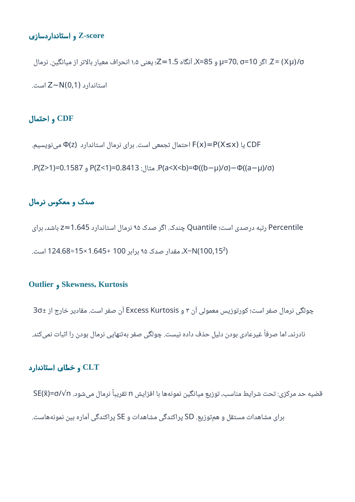
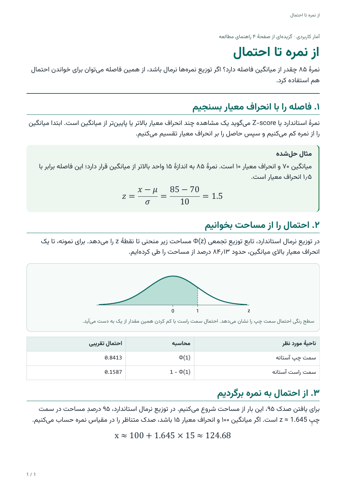

# Persian Educational Skill | طراح جزوهٔ آموزشی فارسی

A global Codex skill for turning lecture slides and academic PDFs into illustrated, print-ready A4 handouts. It follows the language of your reference handout and includes dedicated Persian typesetting.

<div dir="rtl">

این Skill اسلایدها و PDFهای دانشگاهی را به جزوهٔ آموزشی قابل چاپ تبدیل می‌کند. زبان جزوه را می‌توانید مشخص کنید؛ در حالت پیش‌فرض، زبان جزوهٔ مرجع و در نبود آن، زبان منبع درسی انتخاب می‌شود.

</div>

[Installation / راهنمای نصب](#installation) · [First lesson / ساخت اولین جزوه](#first-lesson) · [Design system / نظام طراحی](references/design-system.md)

## Preview | نمونهٔ خروجی

| Before · صفحهٔ اصلی | After · جزوهٔ بازطراحی‌شده |
|:---:|:---:|
| [](docs/images/study-guide-before.png) | [](docs/images/study-guide-after.png) |

The left image is page 4 of `study_guide.pdf`. The right image teaches a selection from that page in three steps. Calculate a Z-score, read a probability from the normal curve, then work backwards from a percentile. Click either image to inspect the print rendering.

<div dir="rtl">

تصویر سمت چپ صفحهٔ ۴ راهنمای آمار کاربردی است. تصویر سمت راست سه مفهوم از همان صفحه را با یک مثال حل‌شده، نمودار و جدول توضیح می‌دهد. در متن «۱۵ واحد» می‌خوانید و در فرمول و جدول، رقم‌های انگلیسی می‌بینید. برای دیدن جزئیات، روی تصویر کلیک کنید.

</div>

<a id="installation"></a>

## Installation | نصب سراسری

You need Codex, Git, Python 3.10+ and Poppler. Clone the repository under your user account so Codex can discover the skill across projects. If the skill was already installed at this location, skip the clone step.

<div dir="rtl">

برای نصب به Codex، گیت، پایتون نسخهٔ ۳٫۱۰ یا بالاتر و Poppler نیاز دارید. فرمان‌های مربوط به سیستم‌عامل خود را اجرا کنید. مسیر نصب زیر حساب کاربر شماست و Skill در پروژه‌های مختلف قابل فراخوانی است. اگر Skill از قبل در همین مسیر نصب شده، مرحلهٔ کلون را رد کنید.

</div>

**1. Install Poppler / نصب ابزار رندر PDF**

| Platform | Command |
|---|---|
| Windows (PowerShell) | `winget install --id oschwartz10612.Poppler --exact` |
| macOS (Homebrew) | `brew install poppler` |
| Debian / Ubuntu | `sudo apt install poppler-utils python3-venv` |

**2. Install the skill and its Python environment / نصب Skill و وابستگی‌ها**

Windows · PowerShell

```powershell
$skill = Join-Path $env:USERPROFILE '.agents/skills/persian-educational-designer'
git clone https://github.com/theking12b/persian-educational-skill.git "$skill"
py -3 -m venv "$skill/.venv"
$python = Join-Path $skill '.venv/Scripts/python.exe'
& $python -m pip install -r "$skill/requirements.txt"
& $python -m playwright install chromium
pdftoppm -v
& $python "$skill/scripts/build.py" --help
```

macOS / Linux · Terminal

```sh
skill="$HOME/.agents/skills/persian-educational-designer"
git clone https://github.com/theking12b/persian-educational-skill.git "$skill"
python3 -m venv "$skill/.venv"
python_bin="$skill/.venv/bin/python"
"$python_bin" -m pip install -r "$skill/requirements.txt"
"$python_bin" -m playwright install chromium
pdftoppm -v
"$python_bin" "$skill/scripts/build.py" --help
```

On a minimal Linux installation, use `playwright install --with-deps chromium` through the same Python interpreter if Chromium reports missing system libraries. On Windows, reopen PowerShell if a newly installed Poppler is missing from PATH. The bundled Vazirmatn fonts travel with the templates.

<div dir="rtl">

دو فرمان پایانی، دسترسی به رندرکنندهٔ PDF و ابزار ساخت جزوه را بررسی می‌کنند. در ویندوز اگر فرمان Poppler پس از نصب پیدا نشد، PowerShell را دوباره باز کنید. فونت‌های وزیرمتن همراه قالب نصب می‌شوند. برای اجرای دستی اسکریپت‌ها، از پایتون محیط مجازی همین Skill استفاده کنید.

</div>

<a id="first-lesson"></a>

## First lesson | ساخت اولین جزوه

Start a new Codex chat in your course project and attach the lecture PDF. If you also supply a reference handout, identify which file contains the course material and which sets the language and visual style.

> Use $persian-educational-designer to turn the attached lecture slides into a beginner-friendly handout. Use the second PDF as the language and style reference. Render the final PDF and check every page.

<div dir="rtl">

در پروژهٔ درس یک گفت‌وگوی جدید باز کنید و فایل درس را پیوست کنید. اگر نمونهٔ جزوه هم دارید، نقش هر فایل را در درخواست مشخص کنید.

</div>

> با `$persian-educational-designer` از اسلایدهای پیوست یک جزوهٔ آموزشی بساز. فایل دوم نمونهٔ زبان و سبک است. مثال‌ها را مرحله‌به‌مرحله توضیح بده و صفحه‌های PDF نهایی را بازبینی کن.

Codex maps source pages to teaching sections and checks formulas and examples against the source. The scripts extract text and page images, print the authored HTML with Chromium, and render the PDF for visual review. For manual commands and review criteria, see the [usage guide](references/usage.md) and [quality checklist](references/quality.md).

<div dir="rtl">

Codex مطالب هر صفحهٔ منبع را به بخش مناسب جزوه وصل می‌کند و مثال‌ها و فرمول‌ها را با منبع می‌سنجد. اسکریپت‌ها استخراج صفحات، چاپ HTML و رندر PDF را انجام می‌دهند. راهنمای اجرا و معیارهای بازبینی در پیوندهای بالا آمده‌اند.

</div>
